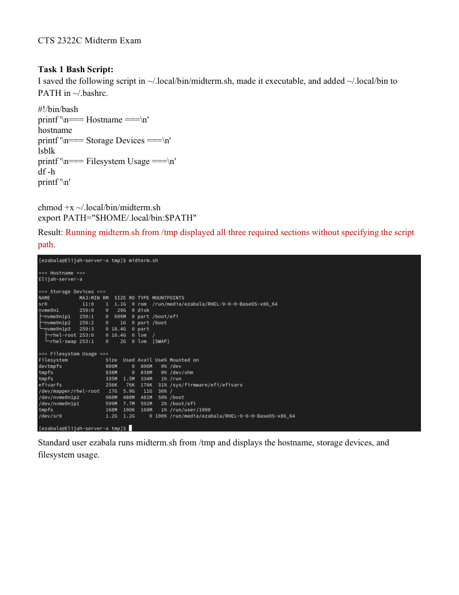
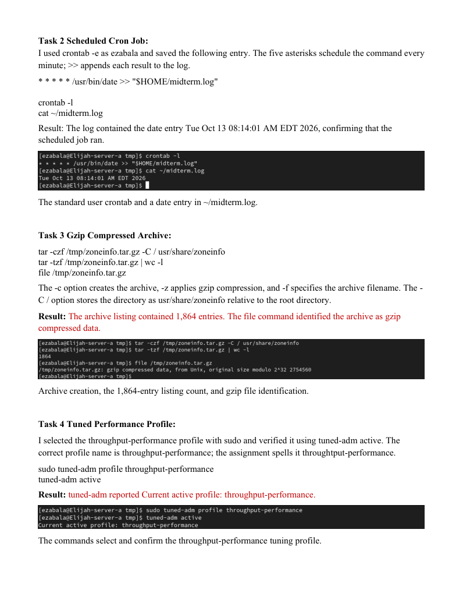
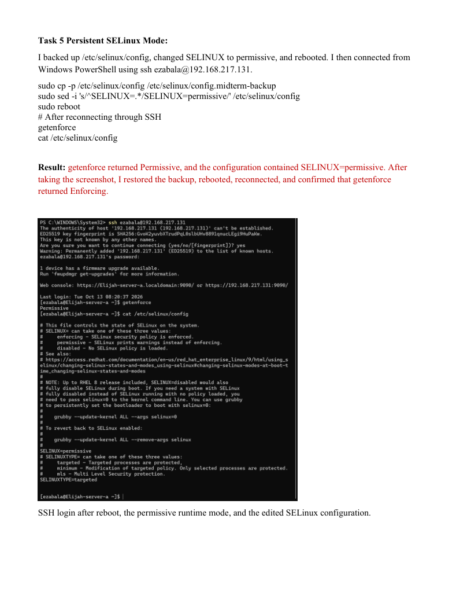

# Bash scripting, cron, archives, tuning, and SELinux

**Environment:** Red Hat Enterprise Linux 9 (authorized virtual lab)

## Project overview
Wrote a Bash system-information script, scheduled a cron log entry, created a gzip archive, verified a tuned profile, and tested a reversible SELinux mode change.

## Skills and tools
- `hostname`, `lsblk`, `df -h`
- `crontab -l`
- `tar -czf`
- `tuned-adm active`
- `getenforce`

## Evidence
The screenshots below were taken from my completed course lab submissions. They document the lab environment and verification steps.

### Evidence 1

### Evidence 2

### Evidence 3

## Scope
All work was performed in an authorized educational virtual environment. Screenshots are presented as lab evidence, not production deployment results.
