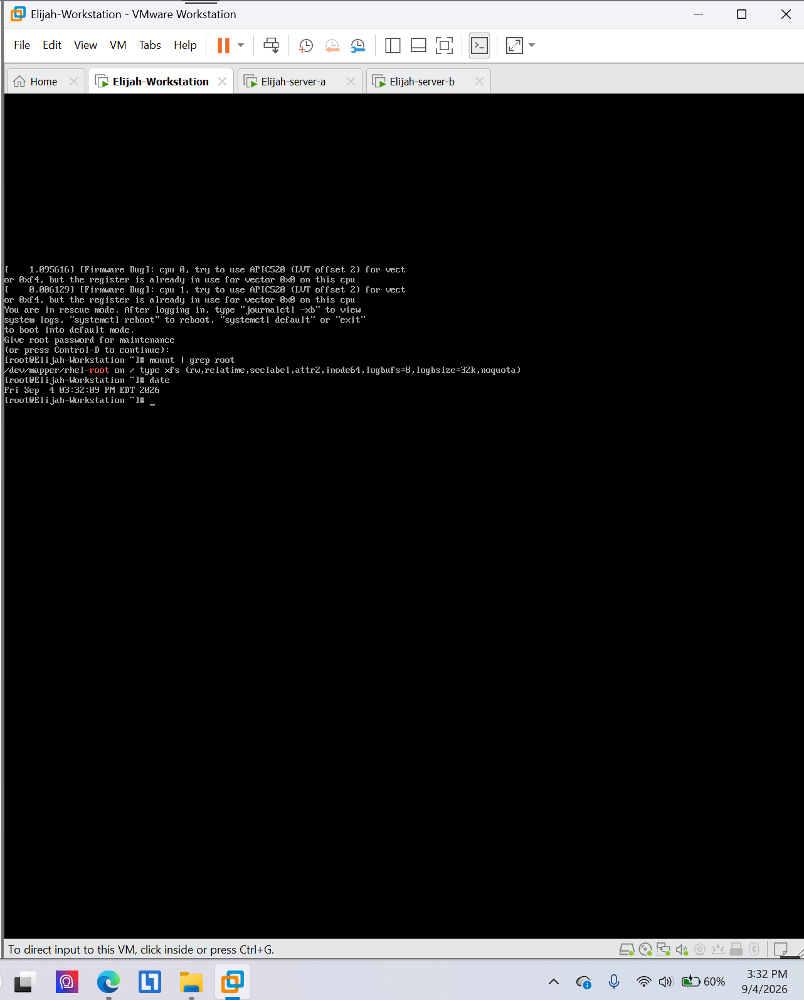
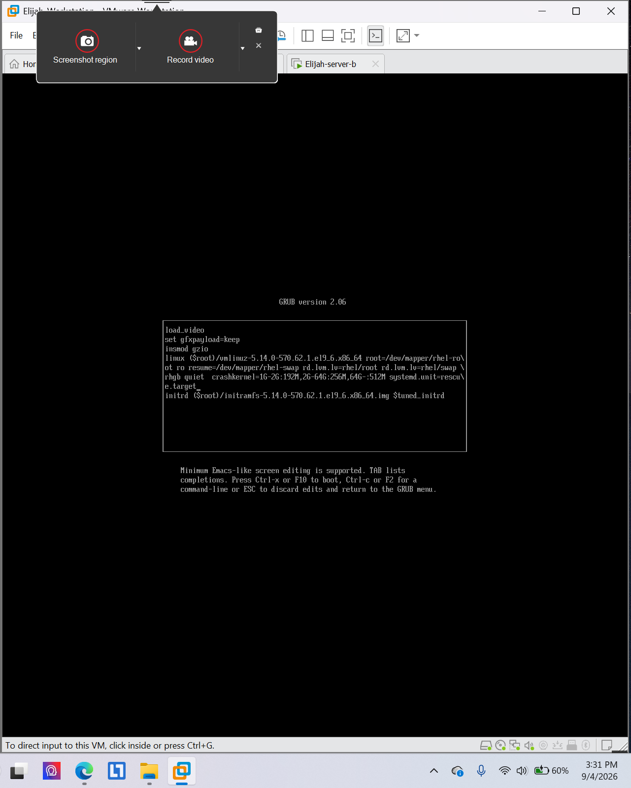
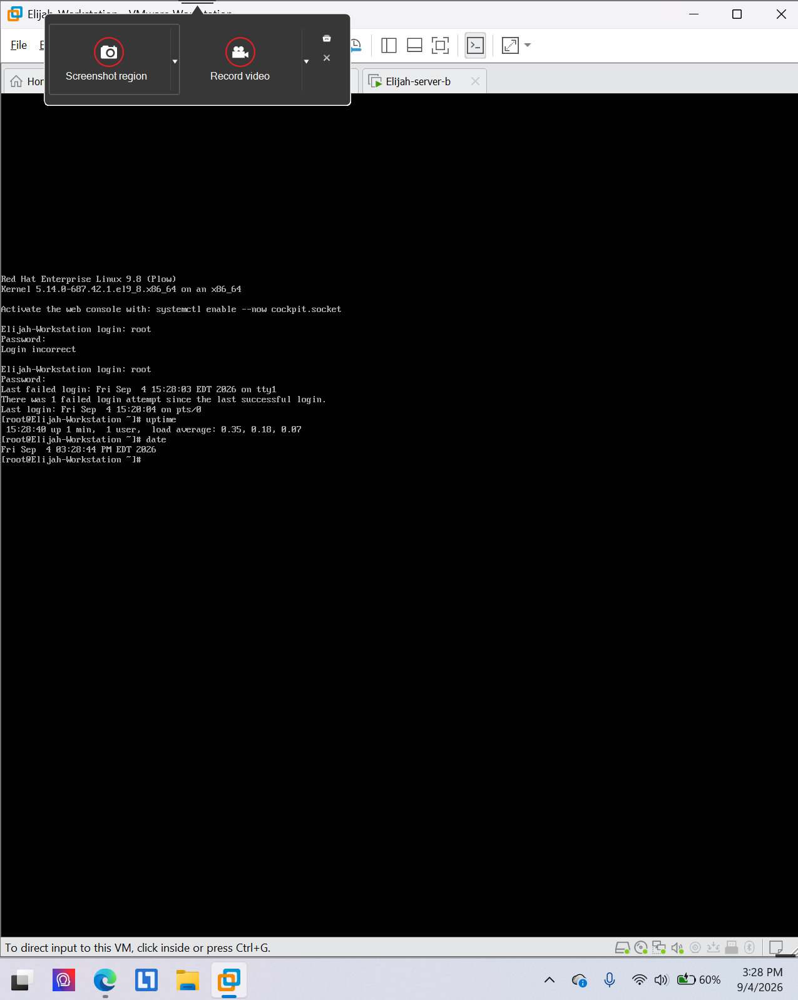

# System boot targets and rescue mode

**Environment:** Red Hat Enterprise Linux 9 (authorized virtual lab)

## Project overview
Verified uptime in a multi-user target, modified a GRUB boot entry to enter rescue mode, and checked the root filesystem mount.

## Skills and tools
- `uptime`
- `systemd.unit=rescue.target`
- `mount | grep root`

## Evidence
The screenshots below were taken from my completed course lab submissions. They document the lab environment and verification steps.

### Evidence 1

### Evidence 2

### Evidence 3

## Scope
All work was performed in an authorized educational virtual environment. Screenshots are presented as lab evidence, not production deployment results.
