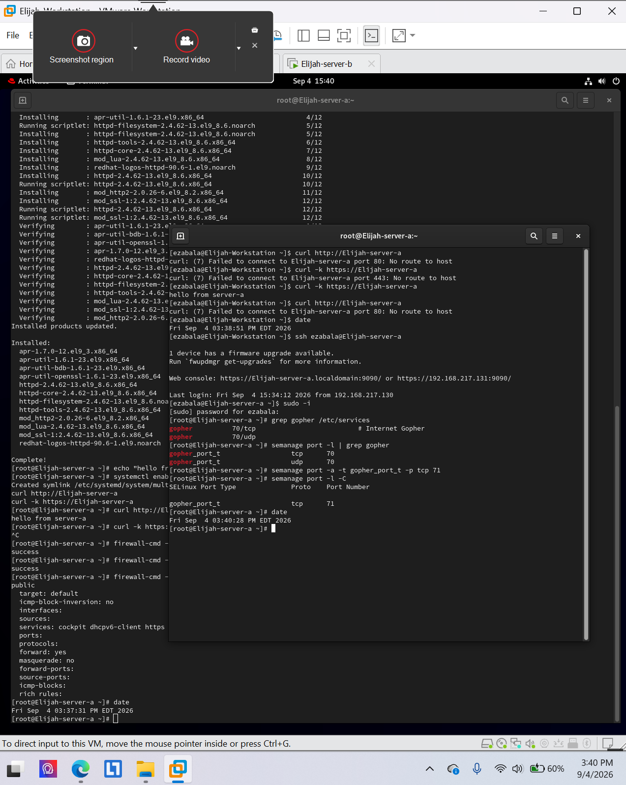
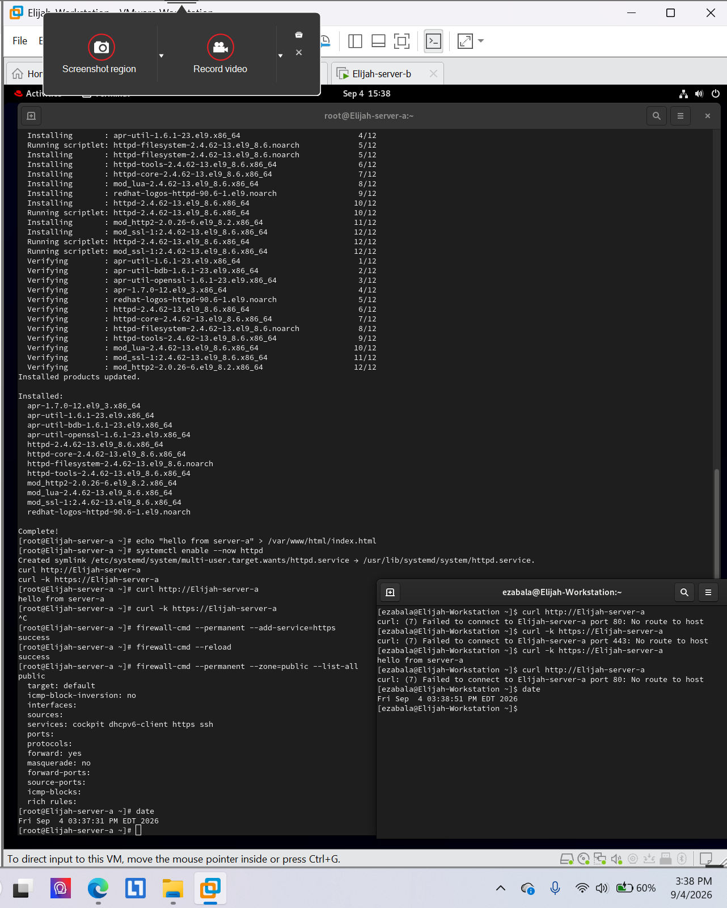
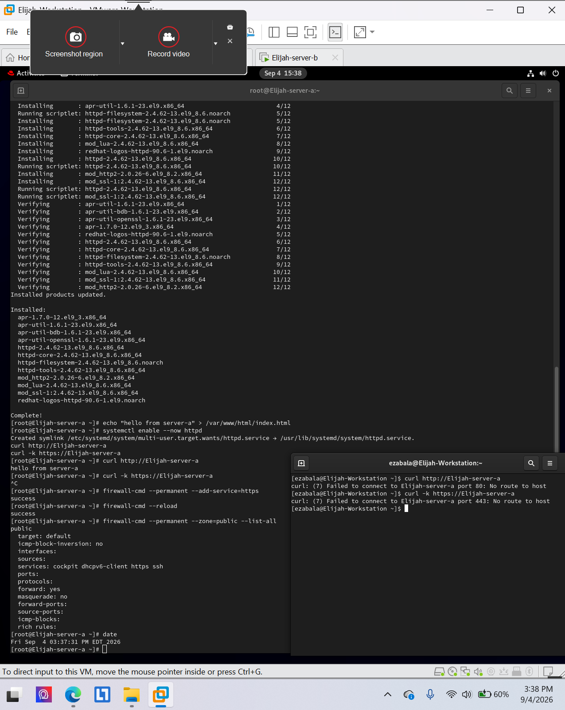

# Firewalld and SELinux port labeling

**Environment:** Red Hat Enterprise Linux 9 (authorized virtual lab)

## Project overview
Configured HTTPS access in the permanent public firewall zone, tested HTTPS versus HTTP access, and inspected a local SELinux port label.

## Skills and tools
- `firewall-cmd`
- HTTPS connectivity test
- SELinux port-label verification

## Evidence
The screenshots below were taken from my completed course lab submissions. They document the lab environment and verification steps.

### Evidence 1

### Evidence 2

### Evidence 3

## Scope
All work was performed in an authorized educational virtual environment. Screenshots are presented as lab evidence, not production deployment results.
