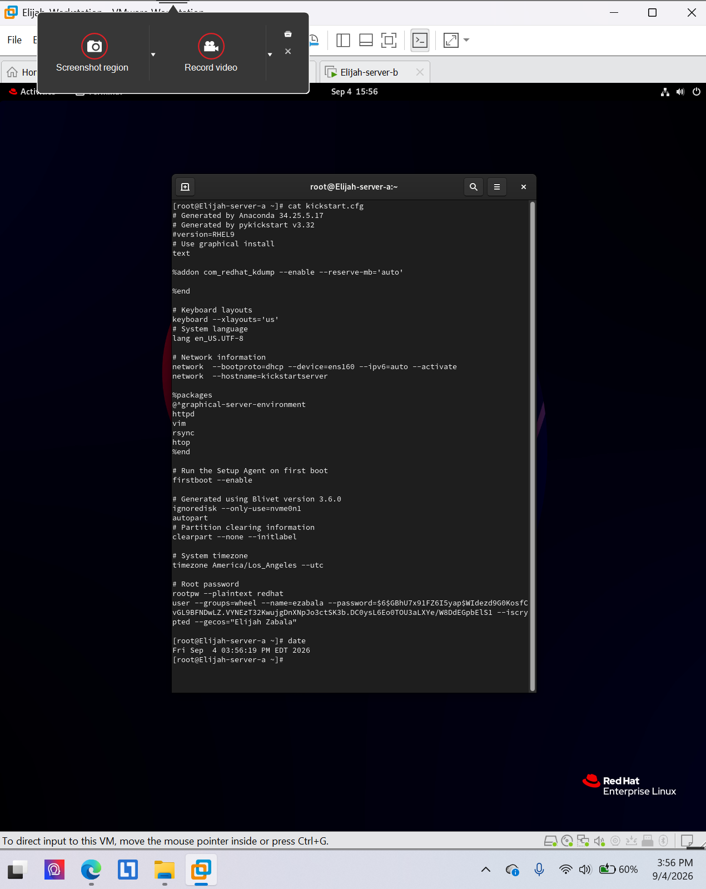

# Kickstart configuration validation

**Environment:** Red Hat Enterprise Linux 9 (authorized virtual lab)

## Project overview
Validated a Kickstart configuration using `ksvalidator`. A configuration screenshot containing password-hash material is intentionally excluded.

## Skills and tools
- `ksvalidator kickstart.cfg`

## Evidence
The screenshots below were taken from my completed course lab submissions. They document the lab environment and verification steps.

### Evidence 1

## Scope
All work was performed in an authorized educational virtual environment. Screenshots are presented as lab evidence, not production deployment results.
