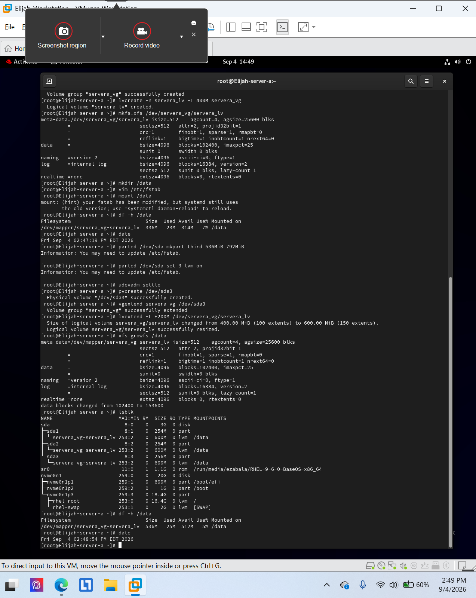
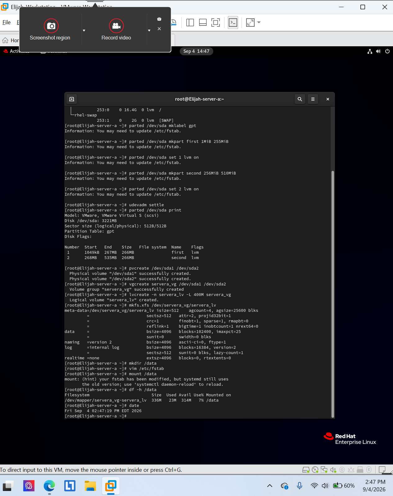

# Logical Volume Management (LVM)

**Environment:** Red Hat Enterprise Linux 9 (authorized virtual lab)

## Project overview
Created and mounted a logical volume at `/data`, extended its size and XFS filesystem, and verified the resulting configuration.

## Skills and tools
- `df -h /data`
- `lsblk` and volume extension verification

## Evidence
The screenshots below were taken from my completed course lab submissions. They document the lab environment and verification steps.

### Evidence 1

### Evidence 2

## Scope
All work was performed in an authorized educational virtual environment. Screenshots are presented as lab evidence, not production deployment results.
