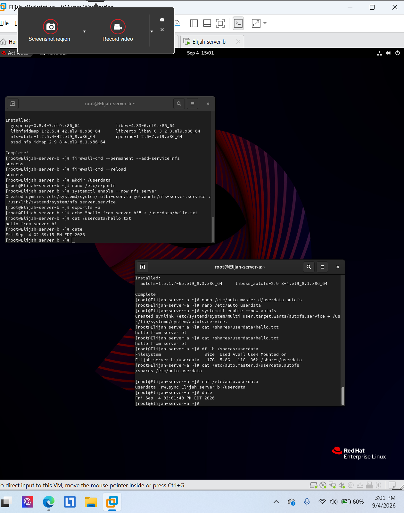

# NFS sharing and autofs

**Environment:** Red Hat Enterprise Linux 9 (authorized virtual lab)

## Project overview
Verified an NFS export from a second lab server and configured automatic mounting at `/shares/userdata`.

## Skills and tools
- NFS mount verification
- autofs map and mounted-path verification

## Evidence
The screenshots below were taken from my completed course lab submissions. They document the lab environment and verification steps.

### Evidence 1

### Evidence 2

## Scope
All work was performed in an authorized educational virtual environment. Screenshots are presented as lab evidence, not production deployment results.
