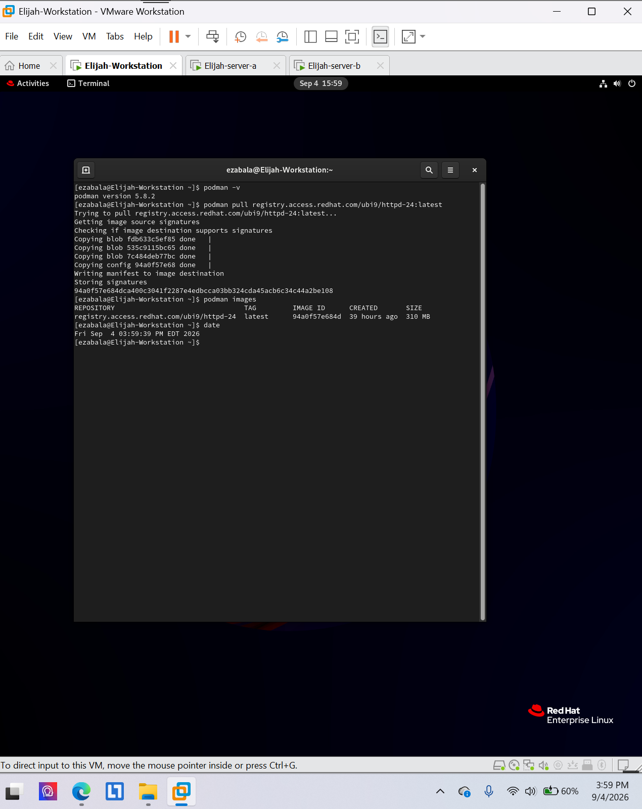
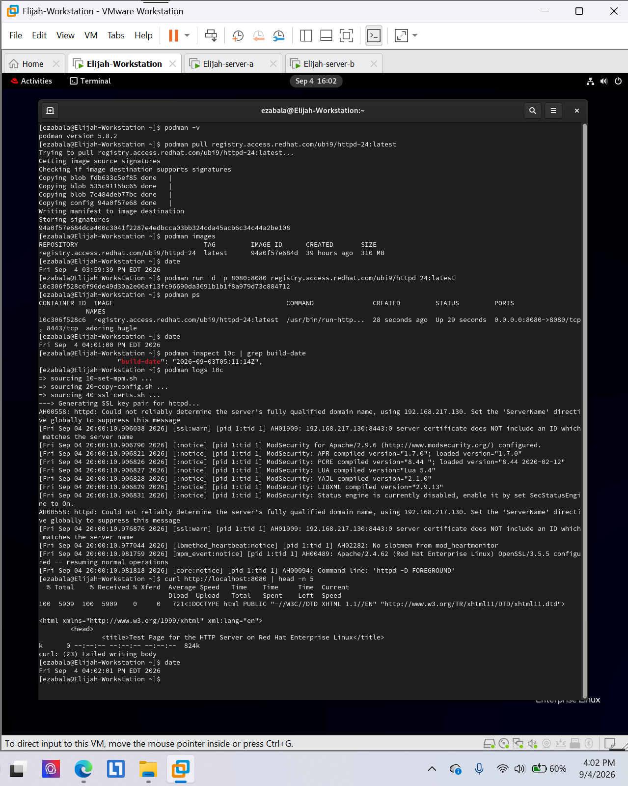
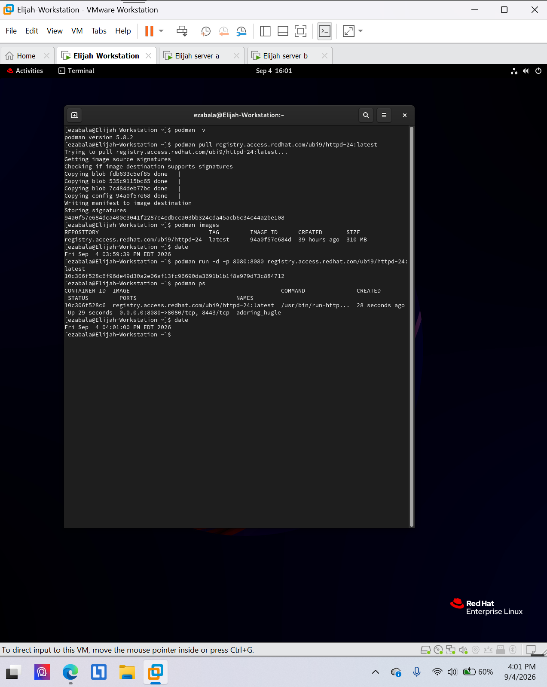

# Podman and Apache HTTP server

**Environment:** Red Hat Enterprise Linux 9 (authorized virtual lab)

## Project overview
Pulled a Red Hat UBI HTTPD image, confirmed a running container with port 8080 mapping, and tested the server using `curl`.

## Skills and tools
- `podman images`
- `podman ps`
- `curl`

## Evidence
The screenshots below were taken from my completed course lab submissions. They document the lab environment and verification steps.

### Evidence 1

### Evidence 2

### Evidence 3

## Scope
All work was performed in an authorized educational virtual environment. Screenshots are presented as lab evidence, not production deployment results.
