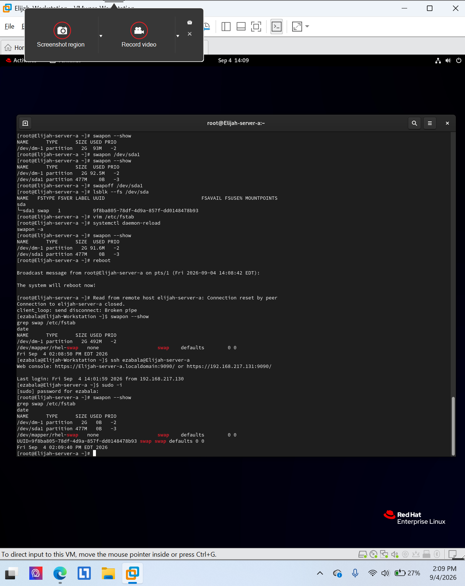
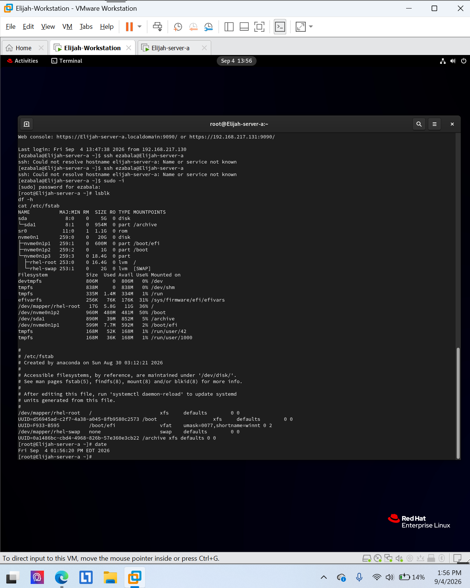

# XFS filesystems and persistent mounts

**Environment:** Red Hat Enterprise Linux 9 (authorized virtual lab)

## Project overview
Verified an XFS filesystem mounted at `/archive` after reboot, and verified persistent swap configuration.

## Skills and tools
- `lsblk`, `df -h`, `/etc/fstab`
- `swapon --show`, `grep swap /etc/fstab`

## Evidence
The screenshots below were taken from my completed course lab submissions. They document the lab environment and verification steps.

### Evidence 1

### Evidence 2

## Scope
All work was performed in an authorized educational virtual environment. Screenshots are presented as lab evidence, not production deployment results.
