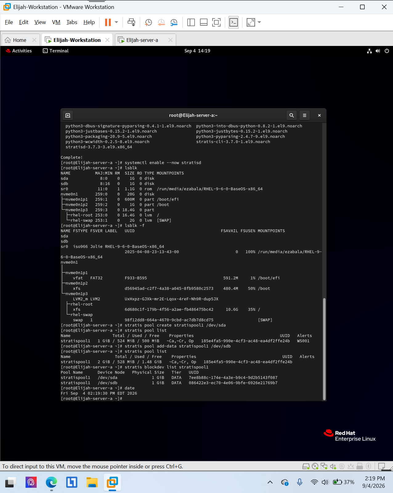
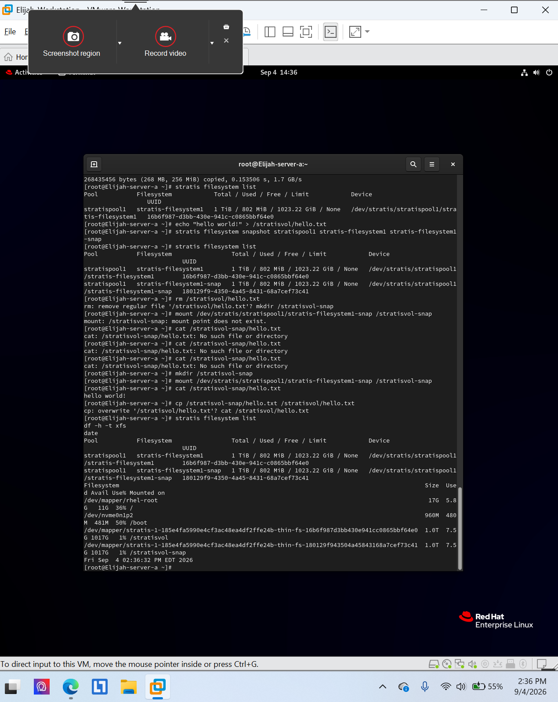
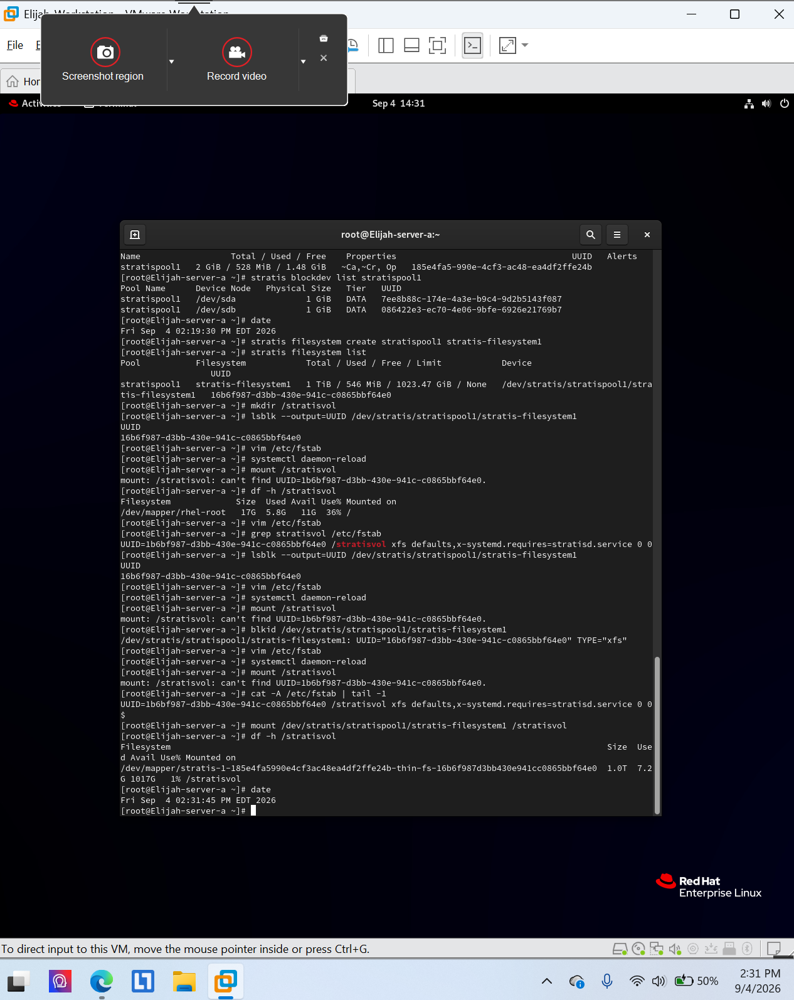

# Stratis layered storage and snapshots

**Environment:** Red Hat Enterprise Linux 9 (authorized virtual lab)

## Project overview
Created a Stratis storage pool using two virtual disks, mounted a filesystem at `/stratisvol`, and verified a filesystem snapshot.

## Skills and tools
- Stratis pool and block-device inspection
- Filesystem mount and snapshot verification

## Evidence
The screenshots below were taken from my completed course lab submissions. They document the lab environment and verification steps.

### Evidence 1

### Evidence 2

### Evidence 3

## Scope
All work was performed in an authorized educational virtual environment. Screenshots are presented as lab evidence, not production deployment results.
